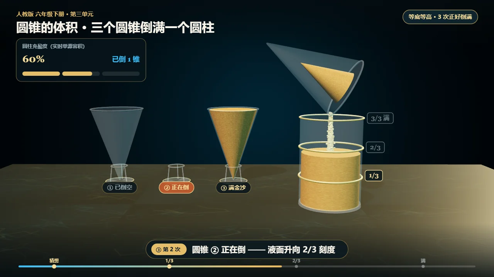
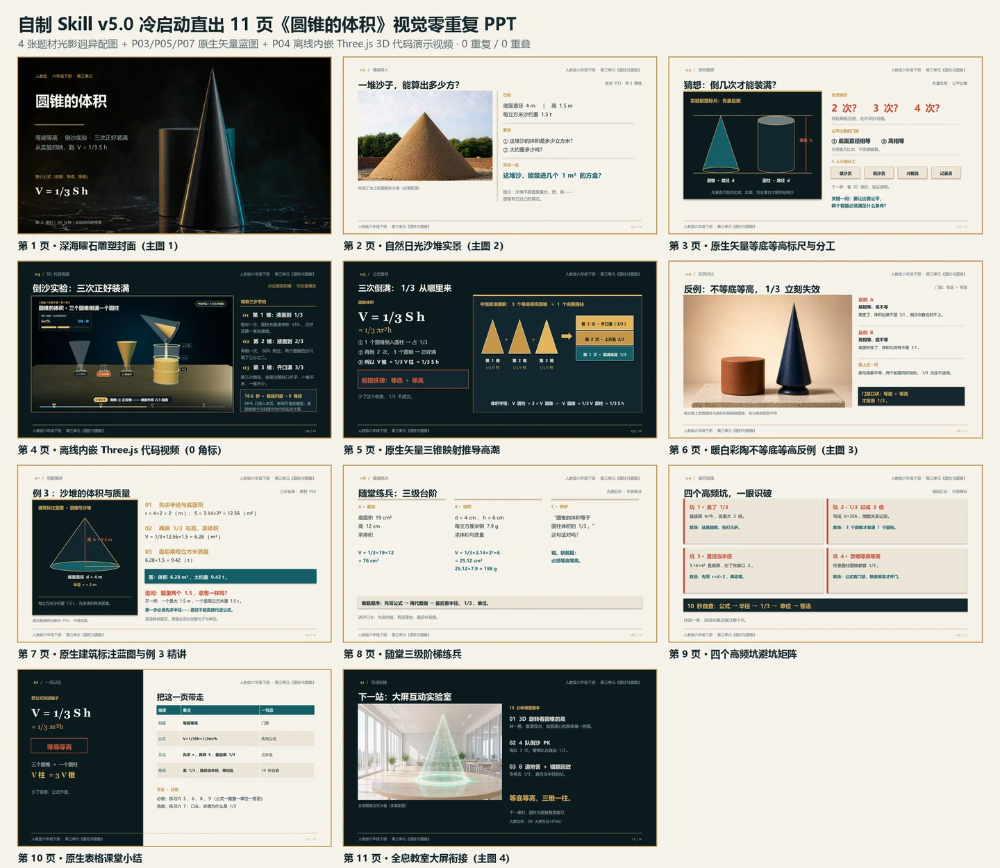
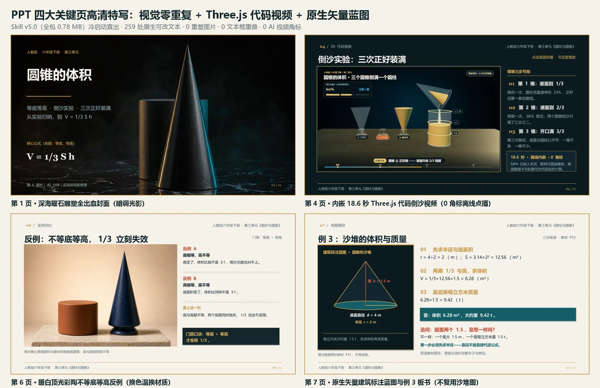
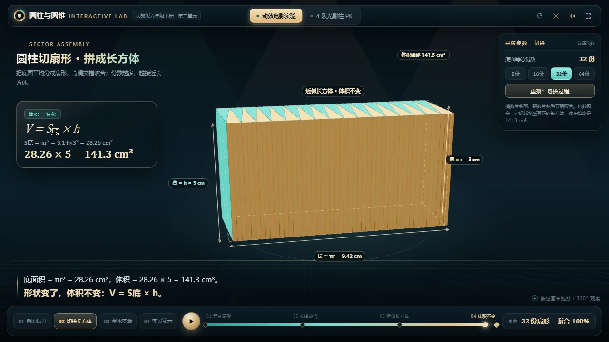
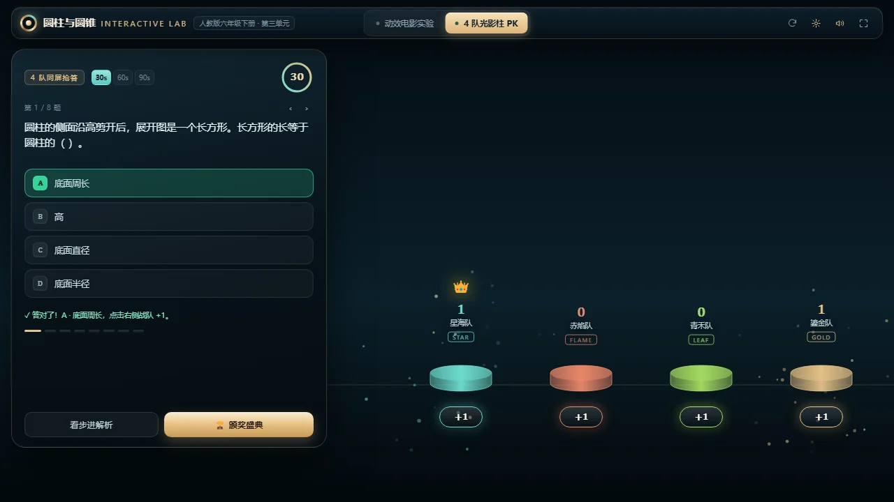

<div align="center">


<h1>K12 Lesson Studio · All-Subject Teaching Prep Skill</h1>

**An accuracy-first, unified-CLI AI Agent Skill for all-subject K12 lesson prep (< 0.90 MB total · Zero npm dependencies).**

Turn any textbook PDF (electronic or scanned) or lesson topic into a verified 5-step classroom kit via `k12_studio.py`: textbook scope & anti-hallucination checklist · printable DOCX lesson plans with classroom rescue scripts · zero-duplicate all-subject editable 11-slide PPTX decks · deterministic Three.js code-rendered 3D videos (zero AI watermarks) · single-file offline 3D interactive HTML labs with 4-team classroom PK · single-source verified student/red-ink teacher exams & remediation cards.

[](https://github.com/magicjacky/k12-lesson-studio/stargazers)
[](#installation)
[](#installation)
[](#installation)
[](#repository-layout)
[](LICENSE)

[简体中文](./README.md) · **English**

[Showcase](#showcase) · [Quick Start](#quick-start) · [Architecture](#core-architecture) · [Subject Routing](#all-subject-routing) · [CLI & Audits](#cli--automated-audits) · [Repo Layout](#repository-layout) · [License](#license)

</div>

<p align="center">
  
</p>

---

## What is K12 Lesson Studio

`k12-lesson-studio` is a deterministic, audit-gated **AI Agent Skill** engineered around a single rule: **100% curriculum, formula, and geometric accuracy first; museum-editorial visual craft second.** Instead of relying on fragile ad-hoc prompts or heavy 400 MB rendering frameworks, the entire skill stays under **0.85 MB uncompressed** with zero `npm install` steps:

- **Deterministic Three.js Code Video Engine (`assets/three.min.js` + `assets/video_stage.html` + `scripts/render_video.mjs`)**: Renders mathematically exact 1280×720 30fps H.264+AAC MP4 teaching videos via headless Chrome CDP + procedural Node WAV audio synthesis (pouring sand/water, calibrated chimes, finale triad). Zero AI morphing, zero platform watermarks, and built-in rigid glassware + inverse-kinematics pouring primitives.
- **Zero-Duplicate Editable PPTX & Vector Blueprint Kit (`scripts/ppt_kit.py` + `scripts/audit_pptx.py`)**: Enforces 4 distinct visual worlds max + native editable vector diagrams for lab gauges, derivation schematics, and dimensioned blueprints. `audit_pptx.py` automatically enforces **SHA-256 zero duplicate images**, zero placeholders, zero text overlaps, full speaker notes, embedded MP4 presence, and 1-shot LibreOffice contact sheets.
- **Single-File Offline 3D Interactive Classroom Lab (`assets/theater_base.html` + `scripts/build_html.py` + `scripts/audit_html.mjs`)**: Bundles a 1280×720 safe-zone 3D theater, synced offline `<video>` playback, 4-team 3D energy-pillar PK arena, and delegated native `<dialog>` modals into a ~1 MB single HTML file that opens offline on any classroom whiteboard.
- **Textbook-Anchored Anti-Hallucination Workflow (`scripts/extract_textbook.py` + `scripts/md_to_docx.py` + `scripts/doctor.py`)**: Extracts exact unit pages & curriculum boundaries from real textbook PDFs, verifies every exam total and answer via Python assertions, and turns grading analytics into printable 1-page remediation cards + 3-tier practice sets.

---

## Showcase

All visuals below were generated end-to-end by an AI agent in a clean workspace using `k12-lesson-studio` (Demo unit: Grade 6 Math *Cylinders & Cones*):

<table>
  <tr>
    <td width="50%" align="center">
      <br />
      <sub><b>11-Slide Zero-Duplicate Editable PPTX</b> (4 distinct visual worlds · 259 editable text shapes · 0 duplicates · 0 overlaps)</sub>
    </td>
    <td width="50%" align="center">
      <br />
      <sub><b>Visual Variety Close-Up</b> (Obsidian cover · Embedded Three.js MP4 · Ceramic counterexample · Native vector blueprint)</sub>
    </td>
  </tr>
  <tr>
    <td width="50%" align="center">
      <br />
      <sub><b>998 KB Offline 3D Interactive Lab</b> (360° orbit drag · 8–64 wedge interlock · scrubbable timeline)</sub>
    </td>
    <td width="50%" align="center">
      <br />
      <sub><b>4-Team 3D Pillar Classroom PK</b> (Countdown quiz · step-by-step modal · trophy podium)</sub>
    </td>
  </tr>
</table>

---

## Quick Start

### Installation

```bash
# Option 1: npx skills
npx skills add https://github.com/magicjacky/k12-lesson-studio --skill k12-lesson-studio
```

- **Option 2 (Desktop AI Agent — WorkBuddy / Claude Code / Codex / Cursor)**: Ask your agent to install `magicjacky/k12-lesson-studio` into its global skills directory and run `python scripts/doctor.py setup --mirror` if any Python package is missing.
- **Option 3 (WorkBuddy Skill Market)**: Search **`中小学全学科课件一键制作`** or **`k12-lesson-studio`** once listed.

---

## Core Architecture

| Layer | Files | Guarantees |
|---|---|---|
| **Environment Self-Check** | `scripts/doctor.py` | Pure-stdlib readiness check + mirror-accelerated pip setup (`pymupdf`, `python-docx`, `python-pptx`, `pillow`) |
| **Three.js Video Studio** | `assets/three.min.js`, `assets/video_stage.html`, `scripts/render_video.mjs` | Deterministic 1280×720 30fps WebGL rendering + synthesized WAV audio + automatic 4×4 contact sheet (zero `npm` install) |
| **Editable PPTX Studio** | `scripts/ppt_kit.py`, `scripts/audit_pptx.py` | 16:9 museum-editorial layouts, native vector diagrams, offline MP4 embed, SHA-256 duplicate-image blocker, overlap detector |
| **Offline 3D HTML Theater** | `assets/theater_base.html`, `scripts/build_html.py`, `scripts/audit_html.mjs` | Single-file offline builder + automated Chrome CDP verification (0 external URLs, 0 errors, real modal click checks, 4×4 contact sheet) |
| **Textbook & DOCX Pipeline** | `scripts/extract_textbook.py`, `scripts/md_to_docx.py` | Lossless PDF unit extraction with bookmarks + compact printable A4 DOCX generation |

---

## All-Subject Routing

Automatically adapts themes, visual worlds, Three.js scenes, and curriculum guardrails across **Math, Chinese Literature, English, Physics, Chemistry, Biology, and History/Geography** via `references/subject-playbooks.md`.

---

## CLI & Automated Audits

```bash
python k12_studio.py doctor
python k12_studio.py package-audit
python k12_studio.py render-video --scene .build/scene.js --out demo.mp4 --compact-out compact.mp4 --poster poster.png --contact-sheet sheet.png
python k12_studio.py audit-pptx deck.pptx --render-sheet ppt_sheet.png
python k12_studio.py audit-html lab.html --shots-dir .build/audit_shots
python k12_studio.py verify-exam .build/exam_spec.json --export-student-md .build/student.md --export-teacher-md .build/teacher.md
```

---

## Repository Layout

```text
k12-lesson-studio/
├─ k12_studio.py · SKILL.md · workbuddy.json · _icon.svg · LICENSE · requirements.txt
├─ assets/        (three.min.js, video_stage.html, theater_base.html, theater_config.schema.json, exam_spec.schema.json)
├─ scripts/       (doctor.py, extract_textbook.py, md_to_docx.py, render_video.mjs, ppt_kit.py, audit_pptx.py, build_html.py, audit_html.mjs, verify_exam.py)
├─ references/    (media-prompt-engineering.md, themes.md, subject-playbooks.md, interactive-html-blueprint.md, lesson-and-exam-templates.md)
└─ docs/images/   (GitHub README showcase WebP screenshots — excluded from WorkBuddy Open Platform 2-level ZIP)
```

---

## License

Released under the **[PolyForm Noncommercial License 1.0.0](LICENSE)**. Free for personal K12 teaching, research, parent tutoring, and noncommercial education; commercial resale, paid course bundling, or commercial deployment requires written permission from the author (FengzeAI / magicjacky).
