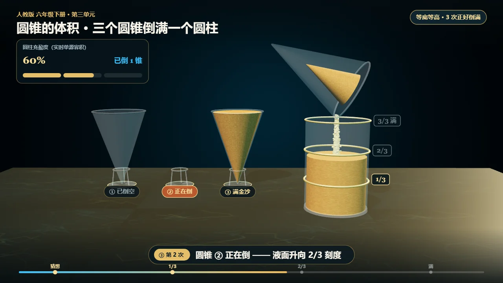
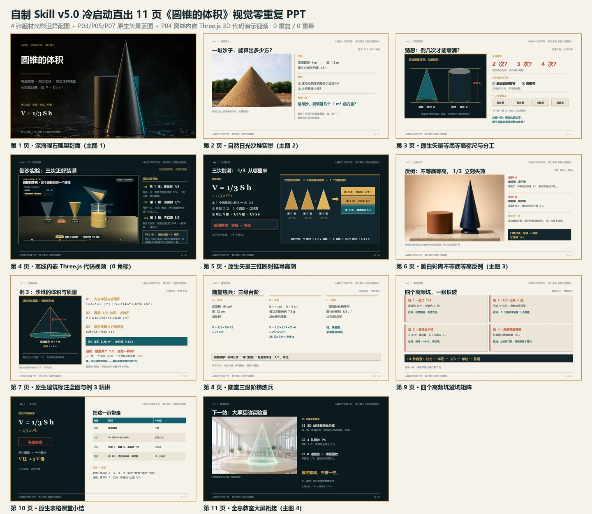
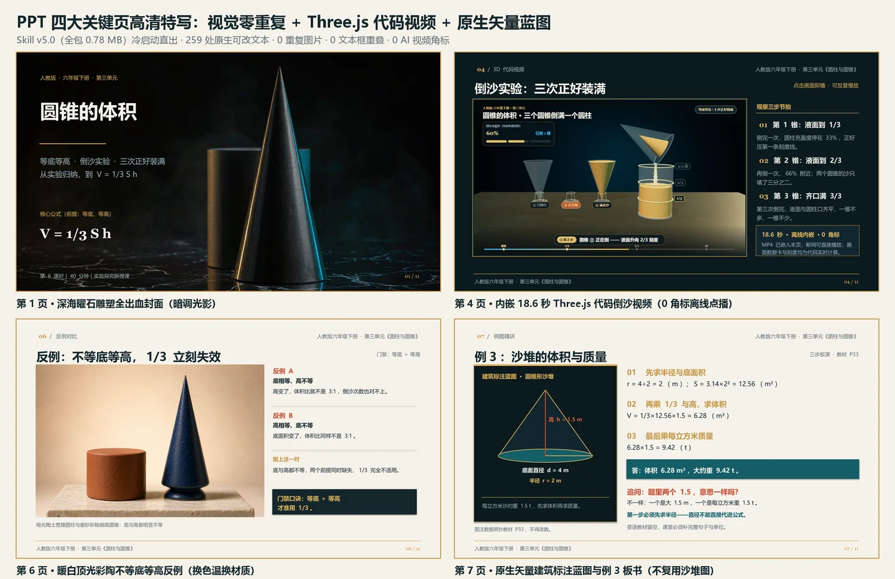
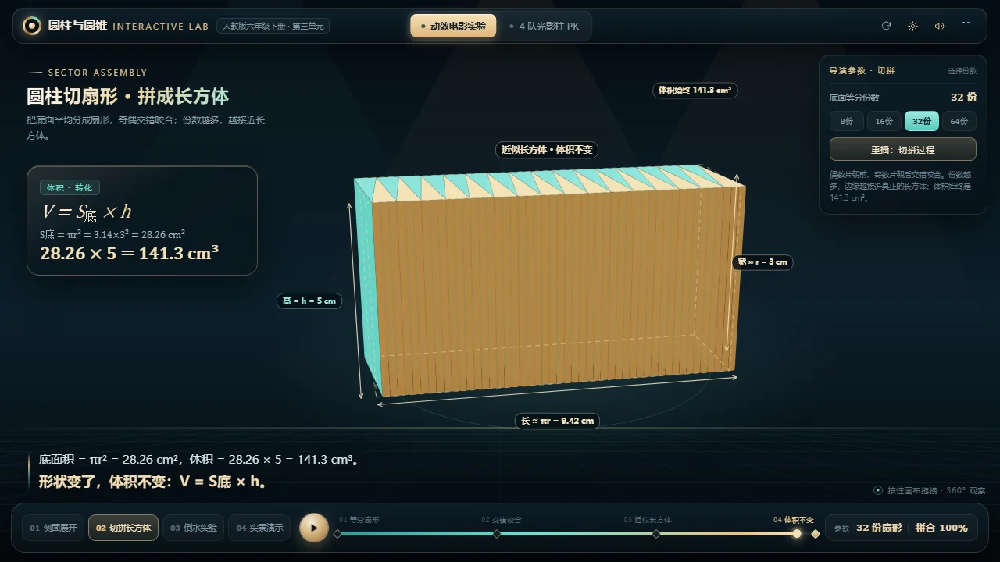
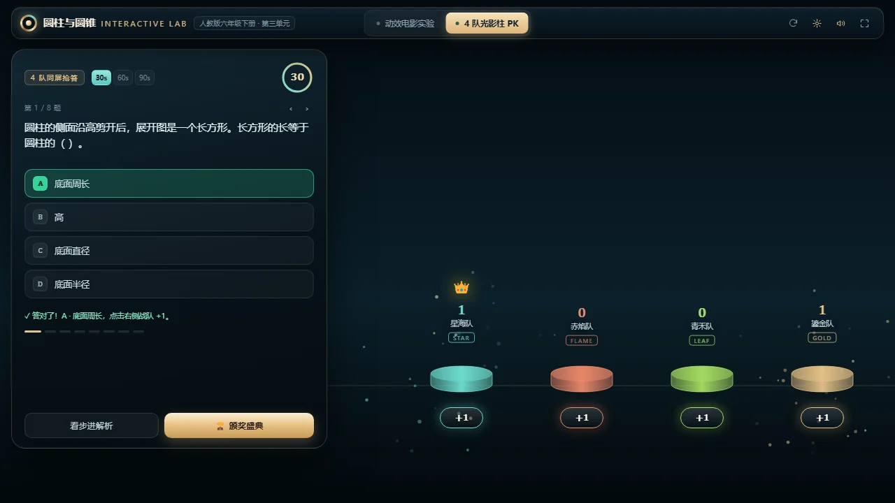
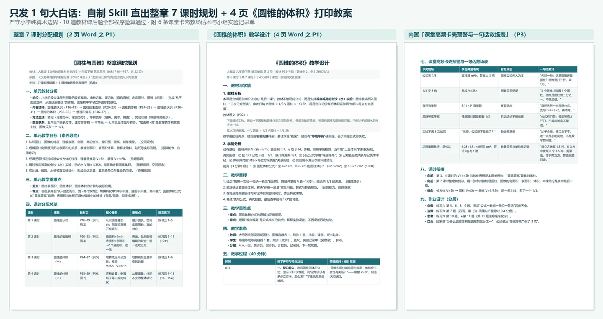
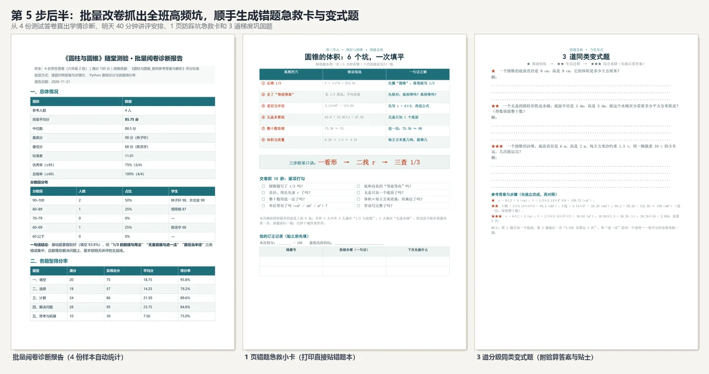

<div align="center">


<h1>K12 Lesson Studio · 中小学全学科课件一键制作</h1>

**面向 AI Agent 的中小学全学科工程级备课技能（全包 < 0.90 MB · 统一单入口 CLI · 零重型依赖）**

输入正版教材 PDF（兼容电子版与纯图片扫描件）或教学课题，通过统一入口 `k12_studio.py` 串联完成 5 步可验真备课闭环：真教材版本核验与防超纲清单 · 带课堂救场表的打印版 Word 教案 · 视觉零重复希沃可编辑 11 页全学科 PPT · 内置 Three.js 确定性代码渲染 0 角标 3D 教学视频 · 断网单文件全学科主题 3D 互动实验与 4 队大屏 PK 网页 · 单源验算学生作答卷/教师红笔解析卷与错题急救卡。

[](https://github.com/magicjacky/k12-lesson-studio/stargazers)
[](#安装方式)
[](#安装方式)
[](#安装方式)
[](#仓库结构)
[](LICENSE)

**简体中文** · [English](./README.en.md)

[实测效果展示](#实测效果展示) · [30 秒快速开始](#30-秒快速开始) · [核心工程架构](#核心工程架构) · [全学科自动适配](#全学科自动适配) · [5 步工作流与验收脚本](#5-步工作流与验收脚本) · [仓库结构](#仓库结构) · [常见问题](#常见问题) · [许可协议](#许可协议)

</div>

<p align="center">
  
</p>

---

## K12 Lesson Studio 是什么

`k12-lesson-studio` 不是一段依赖模型临场发挥的长 Prompt，而是一套把**「第一优先准确、第二优先好看」**写进可执行代码底盘与自动验收门禁里的 **AI Agent Skill**（全技能包未压缩总体积不到 **0.85 MB**，无需安装数百 MB 的 `node_modules` 或重型渲染框架）：

- **内置轻量化 Three.js 代码视频引擎（`assets/three.min.js` + `assets/video_stage.html` + `scripts/render_video.mjs`）**：彻底告别通用 AI 视频工具的物理穿帮、刻度漂移与平台角标；通过 Chrome CDP 确定性逐帧渲染 + 纯 Node 拟声音频合成，离线直出 1280×720 30fps 带声 H.264 MP4，精准对齐数学公式与物理过程。
- **视觉零重复 PPT 拼装与原生矢量蓝图库（`scripts/ppt_kit.py` + `scripts/audit_pptx.py`）**：严控 4 槽位差异化视觉世界，探究标尺、公式推演与例题标注采用 100% PPT 原生矢量图形；内置 SHA-256 重复图片拦截、0 占位符、0 越界、0 文本框重叠与全页讲稿备注自动验收，兼容希沃白板 / WPS / PowerPoint 双击改字。
- **离线单文件 3D 大屏互动剧场底盘（`assets/theater_base.html` + `scripts/build_html.py` + `scripts/audit_html.mjs`）**：内置 1280×720 五大非重叠安全区、自然 3/4 俯视 3D 相机、离线视频倍速播放器、4 队 3D 光影柱 PK 与原生 `<dialog>` 弹窗，打包后单文件约 1 MB，U 盘拷进教室断网双击浏览器秒开。
- **真教材与 Python 断言防幻觉链路（`scripts/extract_textbook.py` + `scripts/md_to_docx.py` + `scripts/doctor.py`）**：先从正版 PDF 锁定版本页码与禁超纲红线，再用 Python 单源验算所有教案答案、100 分试卷分值与批量阅卷统计数字，并自动生成「1 页错题急救小卡 + 3 级变式题」。

---

## 实测效果展示

以下画面均由 WorkBuddy 在全新空白工作空间内，直接调用本 Skill 端到端冷启动生成（案例：人教版小学数学六年级下册第三单元《圆柱与圆锥》）：

<table>
  <tr>
    <td width="50%" align="center">
      <br />
      <sub><b>11 页视觉零重复可编辑 PPT 总览</b>（4 张题材光影各异主图 · 259 处原生文本 · 0 重复 · 0 重叠）</sub>
    </td>
    <td width="50%" align="center">
      <br />
      <sub><b>四大媒介特写</b>（曜石雕塑封面 · 内嵌 0 角标 Three.js 视频 · 暖白彩陶反例 · 原生建筑标注蓝图）</sub>
    </td>
  </tr>
  <tr>
    <td width="50%" align="center">
      <br />
      <sub><b>断网单文件 3D 大屏互动实验室</b>（998 KB · 360° 拖拽 · 8–64 份扇形咬合 · 时间轴慢放）</sub>
    </td>
    <td width="50%" align="center">
      <br />
      <sub><b>全班 4 队光影柱大屏 PK 模式</b>（倒计时抢答 · 步进解析弹窗 · 水晶环加分烟花 · 颁奖台）</sub>
    </td>
  </tr>
</table>

<details>
<summary><b>展开查看打印版教案与课后阅卷错题急救卡实拍</b></summary>

<br />

<table>
  <tr>
    <td width="50%" align="center">
      <br />
      <sub><b>整章课时规划 + 4 页 A4 打印版教案</b>（含 4 人小组分工单与课堂高频卡壳一句话救场表）</sub>
    </td>
    <td width="50%" align="center">
      <br />
      <sub><b>批量阅卷学情诊断 + 1 页错题急救小卡与 3 级变式题</b>（Python 断言验算 100% 准确）</sub>
    </td>
  </tr>
</table>

</details>

---

## 30 秒快速开始

### 安装方式

#### 方式一：一行命令安装（`npx skills`）

```bash
npx skills add https://github.com/magicjacky/k12-lesson-studio --skill k12-lesson-studio
```

#### 方式二：发给 AI Agent 自动安装（WorkBuddy / Claude Code / Codex / Cursor）

直接把下面这段话发给具备本地工具执行能力的桌面 AI Agent：

```text
请帮我在 GitHub 找到开源项目 magicjacky/k12-lesson-studio 并安装到全局技能目录（确认 SKILL.md、workbuddy.json、assets/、references/、scripts/ 完整就绪）。
如果电脑缺少 Python 运行库，请直接运行 scripts/doctor.py setup --mirror 自动补齐。
```

#### 方式三：WorkBuddy 技能市场一键安装

本仓库已内置 WorkBuddy 原生中文配置（`SKILL.md` 中文元数据、`workbuddy.json` 与 `_icon.svg`）。在 WorkBuddy 技能市场审核上架后，直接搜索 **「中小学全学科课件一键制作」** 或 **`k12-lesson-studio`** 点击安装即可启用。

#### 方式四：手动放入技能目录

将仓库文件夹复制到对应 Agent 的全局技能目录：

```bash
# WorkBuddy (Windows)
%USERPROFILE%\.workbuddy\skills\k12-lesson-studio

# Claude Code / Codex
~/.claude/skills/k12-lesson-studio
~/.codex/skills/k12-lesson-studio
```

### 日常使用示例（零长提示词）

1. 在本地新建一个干净的章节工作空间文件夹，把正版电子课本 PDF 放进 `01-教材/`（如暂无 PDF，也可搭配 WorkBuddy 插件市场现成的教材资源技能获取）。
2. 在同一对话中依次用大白话推进：

```text
# 1. 核对教材并锁死禁超纲红线
用中小学全学科课件一键制作技能，帮我核对 01-教材/ 里的第三单元《圆柱与圆锥》，提取本章原页节选 PDF 并输出《教材核验清单》。

# 2. 排课时 + 出打印教案
按刚核对好的教材做一份整章课时规划，再写出「圆锥的体积」完整教案并存成 A4 打印 Word。

# 3. 视觉零重复 PPT + Three.js 代码演示视频
按刚才定好的教案做 11 页视觉不重复的希沃可编辑 PPT，并用内置 Three.js 代码引擎生成「三只满金沙圆锥倒满等底等高圆柱」带声 3D 视频嵌进第 4 页。

# 4. 断网大屏 3D 互动实验室 + 4 队 PK
把本单元三大动态实验、刚渲染好的 3D 倒沙视频和全班 4 队抢答 PK 赛做成断网双击可打开的单文件 HTML。

# 5. 出卷、批量改卷与错题急救卡
按教材出 100 分学生空白卷与教师解析卷；批改 05-课后测改补/课后测试/ 里的学生答卷，出学情诊断报告和 1 页错题急救小卡 + 3 道梯度变式题。
```

---

## 核心工程架构

| 模块 | 文件路径 | 核心职责与硬性门禁 |
|---|---|---|
| **统一 CLI 与包自检** | `k12_studio.py`<br>`scripts/doctor.py` | 12 个子命令统一调度；纯标准库环境体检与清华镜像一键装包；`package-audit` 静态扫描目录层级与文件引用完整性 |
| **真教材与双卷 Word 引擎** | `scripts/extract_textbook.py`<br>`scripts/md_to_docx.py`<br>`scripts/verify_exam.py`<br>`assets/exam_spec.schema.json` | 电子版/扫描版 PDF 自动识别、书签节选与扫描页自动渲染拼图；单源 100 分双卷导出（学生虚线答题栏 + 防漏答案、教师朱砂红解析）与单源阅卷统计 |
| **Three.js 全科视频引擎** | `assets/three.min.js`<br>`assets/video_stage.html`<br>`scripts/render_video.mjs` | 零 `npm` 依赖，内置器皿倾倒、激光透镜光路、3D 球棍分子、血管/水循环粒子管道、三维力矢量箭头与拟声 WAV 合成，一键双轨直出 1280×720 MP4 + 960×540 轻量 MP4 + 16 格检查表 |
| **全学科 PPT 矢量与版式库** | `scripts/ppt_kit.py`<br>`scripts/audit_pptx.py` | 全科色板 + 自动居中裁切零拉伸 + 原生矢量脉络轴/双栏对比/概念中枢/几何光路蓝图/梯度练兵/避坑矩阵/汇总表；强校验 **0 重复图片（SHA-256）、0 越界、0 重叠、全页 Notes** |
| **离线大屏互动剧场** | `assets/theater_base.html`<br>`assets/theater_config.schema.json`<br>`scripts/build_html.py`<br>`scripts/audit_html.mjs` | 全学科主题预设、1280×720 安全区、俯视 3D 相机、离线视频同步、4 队光影柱 PK 与 `<dialog>` 事件委托；自动校验 0 外链、0 报错、按钮实点关闭并输出 4×4 关键帧拼图 |

---

## 全学科自动适配

Skill 根据教材或课题自动识别学科与学段，查阅 `references/subject-playbooks.md` 切换对应策展色板、4 槽位差异化视觉世界、Three.js 代码演示场景与学科防错红线：

| 学科 | 策展主题 | 学科防错红线 | 3D 代码视频 / 大屏互动原型 |
|---|---|---|---|
| **小学 / 初中数学** | 曜石深海 × 博物馆暖亚麻 | 严守学段算法（小学禁方程），全算式 Python 单源断言验算 | 圆柱展平、8–64 份扇形咬合、三锥倒沙刻度对齐 + 4 队光影柱 PK |
| **语文** | 宋画青绿 × 古宣茶白 | 课文、古诗、朝代与注音逐字对照教材，不编典故 | 水墨时间轴意象漫游、朗读节拍 + 4 队飞花令光柱 PK |
| **英语** | 胶片暖阳 × 釉彩绘本 | 紧扣单元核心词、音标与句型，不超纲塞生僻词 | 场景点读拆音、磁吸词块拼句 + 4 队单词能量塔 PK |
| **物理 / 化学 / 生物** | 暗室激光 × 钛金光学 | 光路/方程式配平/器官流向严格自洽，标明条件与单位 | 激光折射色散、滴定变色结晶、红细胞血流循环 + 4 队能量柱 PK |
| **历史 / 地理 / 道法** | 宋画青绿 / 山河曜石 | 年代、地名、因果与方位严格核实，不虚构史料 | 3D 地形水循环粒子流、历史时空路线演播 + 4 队时空光柱 PK |

---

## 5 步工作流与验收脚本

```bash
# 0. 环境体检与静态包完整性自检（缺库时运行 setup --mirror）
python k12_studio.py doctor
python k12_studio.py package-audit

# 1. 教材 PDF 扫描与原页节选（自动识别扫描件并渲染页面拼图）
python k12_studio.py scan-pdf "01-教材/课本.pdf" --keyword "圆柱"
python k12_studio.py extract-pdf "01-教材/课本.pdf" --start 18 --end 40 --out-pdf "01-教材/节选.pdf" --out-txt .build/raw.txt

# 2. 渲染 Three.js 确定性 3D 代码演示视频（同步产出 PPT 高清版 + HTML 轻量版 + 16 格检查表）
python k12_studio.py render-video --scene .build/scene.js --out "演示视频/demo.mp4" --compact-out .build/compact.mp4 --poster .build/poster.png --contact-sheet .build/video_sheet.png

# 3. 验收可编辑 PPT（含 SHA-256 重复图拦截、重叠检测与 LibreOffice 总览拼图）
python k12_studio.py audit-pptx "03-授课PPT/课件.pptx" --render-sheet .build/ppt_sheet.png

# 4. 拼装单文件离线大屏 HTML 并执行无头浏览器全自动点击验收
python k12_studio.py build-html --config .build/theater_config.json --scenes .build/theater_scenes.js --video .build/compact.mp4 --poster .build/poster.png --out "04-大屏互动HTML/lab.html"
python k12_studio.py audit-html "04-大屏互动HTML/lab.html" --shots-dir .build/audit_shots

# 5. 单源 100 分试卷验算并导出学生作答卷（带虚线答题栏）与教师朱砂红解析卷
python k12_studio.py verify-exam .build/exam_spec.json --export-student-md .build/student.md --export-teacher-md .build/teacher.md
python k12_studio.py docx .build/student.md "05-课后测改补/学生卷.docx" --mode student --compact
python k12_studio.py docx .build/teacher.md "05-课后测改补/教师卷.docx" --mode teacher --compact
```

---

## 仓库结构

```text
k12-lesson-studio/
├─ k12_studio.py                     # 统一单入口命令行（12 个全流程与验收子命令）
├─ SKILL.md                          # Agent Skill 主规范与 WorkBuddy 中文元数据（v5.1）
├─ workbuddy.json                    # WorkBuddy 市场展示配置与示例提示词
├─ _icon.svg                         # 技能专属矢量图标
├─ LICENSE                           # PolyForm Noncommercial License 1.0.0
├─ requirements.txt                  # Python 依赖清单（pymupdf / python-docx / python-pptx / pillow）
├─ assets/
│  ├─ three.min.js                   # 内置单文件 Three.js r147（593 KB，零 npm 依赖）
│  ├─ video_stage.html               # 全学科 Three.js PBR 舞台（器皿/激光透镜/分子/流道/力矢量）
│  ├─ theater_base.html              # 1280×720 全学科主题离线大屏互动剧场与 4 队 PK 底盘
│  ├─ theater_config.schema.json     # 互动剧场 JSON 配置 Schema
│  └─ exam_spec.schema.json          # 100 分单源试卷 JSON Schema
├─ scripts/
│  ├─ doctor.py                      # 环境自检与清华镜像一键装包
│  ├─ extract_textbook.py            # 电子/扫描教材识别、书签节选与扫描页自动渲染拼图
│  ├─ md_to_docx.py                  # A4 教学 Word 生成器（支持学生虚线答题栏、教师红笔解析、急救卡分页）
│  ├─ render_video.mjs               # Chrome CDP 确定性逐帧渲染 + 拟声音频 WAV/MP4 双轨合成器
│  ├─ ppt_kit.py                     # 全学科 16:9 可编辑 PPT 版式与原生矢量图解库（自动居中裁切零拉伸）
│  ├─ audit_pptx.py                  # PPTX 重复图拦截、重叠检测、Notes 与视频验真脚本
│  ├─ build_html.py                  # 离线单文件大屏互动网页拼装与题库校验器
│  ├─ audit_html.mjs                 # 离线 HTML 零外链、弹窗实点与 4×4 关键帧自动验收
│  └─ verify_exam.py                 # 100 分双卷单源导出与批量阅卷防矛盾统计器
└─ references/
   ├─ media-prompt-engineering.md    # 4 槽位视觉防重复矩阵与 Three.js 全科 3D 基元规范
   ├─ themes.md                      # 11 页全科分镜矩阵与学科策展色板
   ├─ subject-playbooks.md           # 语数英理化生史地道法自动路由与防错红线
   ├─ interactive-html-blueprint.md  # 几何/科学不变量合同与 THEATER API 指南
   └─ lesson-and-exam-templates.md   # 教材清单 6 段模板、教案救场表与单源双卷规范
```

> **WorkBuddy 开放平台打包说明**：提交至 WorkBuddy 开放平台时，压缩包遵循官方两级目录规范（仅打包上述 25 个核心运行与参考文件，不包含 `docs/images/`），打包体积约 **250 KB**（未压缩 < 0.90 MB），内置 `python k12_studio.py package-audit` 静态完整性扫描，远低于 3 MB 上限。

---

## 常见问题

**Q：需要安装 Remotion 或几百 MB 的 `node_modules` 吗？**
不需要。本技能内置单文件 `assets/three.min.js` 与纯 Node.js Chrome CDP 逐帧管道（`scripts/render_video.mjs`），只需电脑有 Chrome/Edge、Node.js 和 `ffmpeg` 即可离线直出 1280×720 30fps 带声 MP4。

**Q：生成的 PPT 拖进教室希沃白板后，文字和公式真的能改吗？**
能。所有标题、步骤、公式、标注蓝图与表格均由 `python-pptx` 原生文本框与原生矢量图形构建，不将文字焊死在图片里；`audit_pptx.py` 还会自动校验 0 占位符、0 越界、0 文本框重叠与 0 重复图片。

**Q：批量阅卷支持拍照上传的手写纸质试卷吗？**
规整电子答卷可由脚本自动精准判分；若为真实手写拍照纸质卷，遇到潦草字迹或手绘图形题仍可能识别偏差，正式考试场景务必由教师人工抽检复核。

---

## 许可协议

本项目采用 **[PolyForm Noncommercial License 1.0.0](LICENSE)** 协议开源：

- 中小学一线教师备课授课、教研交流、家长辅导学习及非盈利公益教学**永久免费使用与分享**。
- 未经作者（丰泽AI）书面授权，**禁止任何商业用途与倒卖**（包括售卖技能包、网盘引流倒卖、打包进付费课程/训练营/付费社群、培训机构商业部署或套壳收费服务）。
